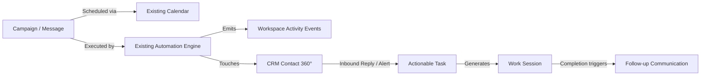
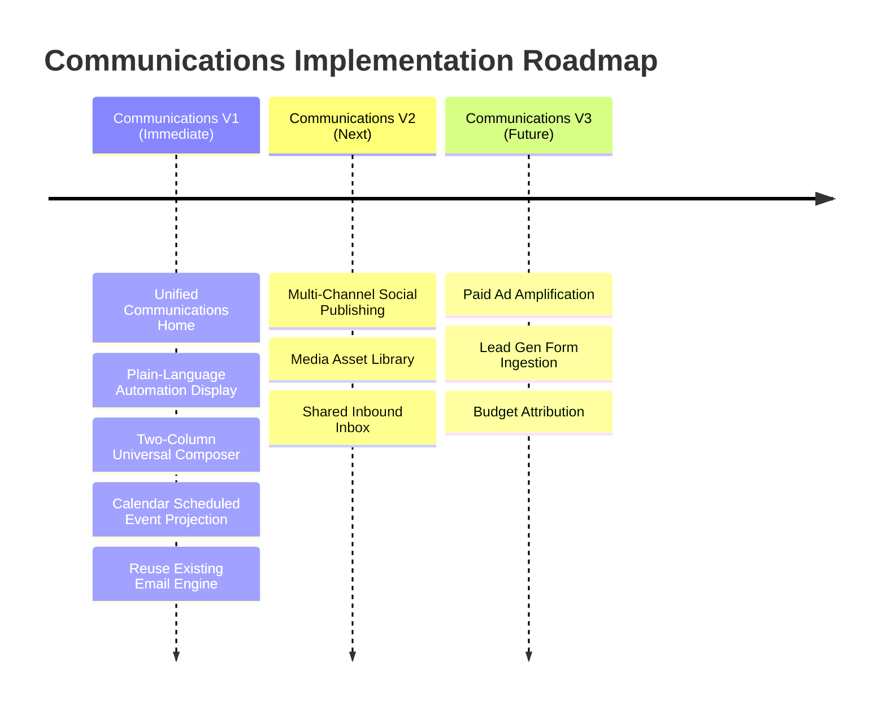

# Communications Architecture & V1 Proposal: Unifying Messages, Automations & Workspace Flow

**Document Version:** 2.0 (Refined Scope & Implementation Architecture)  
**Target Milestone:** Communications V1  
**Status:** Approved Architectural Direction  

---

## 1. Executive Summary & Core Philosophy

Today, 8080 provides an "Automations" desk (internally referred to as "Agents"). While technically robust, **users are confused by the concept of "email agents" and feel constrained by the current UX**. 

Communication in a business is not an isolated platform or a disconnected collection of background cron jobs. **Communications should be another natural producer and consumer of activity across the workspace.**

### The Connected Lifecycle Principle
The same unified object model established for **Work Sessions** applies directly to Communications:
- **Messages & Campaigns** are first-class business objects.
- **Automations** execute actions against those objects using the existing execution engine.
- **Activity Events** record what happened across the workspace.
- **Calendar** displays scheduled message executions alongside tasks, events, and deadlines.
- **CRM** records customer interactions on the contact’s activity timeline.
- **Tasks & Work Sessions** are generated from actionable responses.



A customer reply becomes a task; that task generates a focused Work Session; the completed work triggers a follow-up communication—all linked through a shared workspace history.

---

## 2. Scope Refinement: What We Keep, Simplify, and Defer

To avoid turning this initiative into a high-risk multi-product rebuild, we distill the architecture into an actionable, high-impact **Communications V1** that reuses 8080's existing foundations.

| Proposed Concept | Strategic Decision | Rationale |
| :--- | :--- | :--- |
| **Surface Name** | **Communications** *(not "Communications & Marketing")* | Concise, unambiguous, and covers email, social, team briefs, and customer dialogue. |
| **Top-Level Navigation** | **One Primary Surface** *(not 3 separated views)* | Single low-cognition landing view with contextual filtering and plain-language states. |
| **Composer Layout** | **Two-Column Editor + Live Preview** *(not 3 columns)* | Column 1 (Editor & Controls) + Column 2 (Live Interactive Preview). Clean, responsive, and distraction-free. |
| **Content Calendar** | **Extend Existing Calendar** *(not a new calendar)* | Scheduled communications appear naturally on 8080’s workspace Calendar alongside deadlines. |
| **Activity River** | **Extend Existing Activity Events** *(not a new river)* | Outbound deliveries and inbound replies produce standard workspace activity records. |
| **Backend Engine** | **Preserve Existing Automation Engine** *(no replacement)* | Keep existing schemas, queue workers, sender-verification gates, and delivery rules intact. |
| **One-Click Ad Boost** | **Defer** to future increment | Focus V1 strictly on core communication and messaging clarity. |
| **Ad Attribution** | **Defer** to future increment | Avoid premature complexity before organic publishing and email are mastered. |
| **AI Sentiment Triage**| **Defer** to future increment | Simple rules and direct CRM linkage provide 95% of value with zero prompt fragility. |

---

## 3. The Top View: Single Surface, Contextual Clarity

Instead of forcing users to choose between rigid time-based or platform-based silos, the top-level **Communications** surface provides **one unified homepage** with clean contextual filtering:

```text
┌────────────────────────────────────────────────────────────────────────────────────────┐
│  COMMUNICATIONS                                                  [ + New Message ]     │
│  Scheduled broadcasts, customer lifecycle follow-ups, and team briefs                  │
├────────────────────────────────────────────────────────────────────────────────────────┤
│  Show: [ All (18) ]  [ Active (12) ]  [ Scheduled (4) ]  [ Needs Attention (2) ]       │
│  Channel: [ All Channels ▾ ]    Type: [ All Types ▾ ]       Search: [ Search…        ] │
├────────────────────────────────────────────────────────────────────────────────────────┤
│  CAMPAIGNS & AUTOMATIONS (Summary Table / Cards)                                       │
│  • Company Newsletter       Monthly (1st Mon 9am)   328 Contacts    Active    Next: Nov 3 │
│  • New Customer Welcome     When Contact Won        1-day delay     Active    14 sent/mo │
│  • Weekly Social Spotlight  Every Wed 10am          Followers       Active    Next: Wed  │
│  • Proposal Follow-up       3 days no reply         Leads           Active    5 waiting  │
│  • Sender Alert             Custom SMTP             —               Attention [Fix]      │
├────────────────────────────────────────────────────────────────────────────────────────┤
│  RECENT ACTIVITY & DELIVERIES (Integrated Workspace River)                             │
│  • Today 9:00 AM   Sent: "October Company Newsletter" to 328 contacts (98% delivered)  │
│  • Yesterday       Replied: Sarah Martinez replied to "Welcome Email" → [Create Task]  │
└────────────────────────────────────────────────────────────────────────────────────────┘
```

### Explaining Automations in Plain Language
Users feel constrained when confronted with abstract trigger formulas. The V1 homepage translates internal rules into human-readable sentences:
- *Internal rule:* `family: 'followup', typeKey: 'welcome_new_customer', delayDays: 1`
  → **UI display:** *“When a contact reaches Customer stage, wait 1 day, then send.”*
- *Internal rule:* `family: 'scheduled', repeat: 'monthly', weekday: 1`
  → **UI display:** *“Sent on the first Monday of every month at 9:00 AM.”*
- *Internal rule:* `family: 'followup', typeKey: 'checkin_no_reply', noReplyDays: 7`
  → **UI display:** *“When outreach receives no reply for 7 days, follow up.”*

---

## 4. The Universal Composer: Two-Column Studio

Instead of a cramped 3-column split, the Universal Composer uses a balanced **Two-Column Layout (Editor + Live Device Preview)**:

```text
┌──────────────────────────────────────────────┬──────────────────────────────────────────────┐
│ COLUMN 1: COMPOSE & TARGETING (50%)          │ COLUMN 2: LIVE SIMULATOR PREVIEW (50%)       │
├──────────────────────────────────────────────┼──────────────────────────────────────────────┤
│ Name: [ October Customer Update            ] │ Preview As: [ 💻 Desktop ] [ 📱 Mobile ]     │
│                                              │ Channel Tab: [ 📧 Email ] [ 💬 Social/Chat ] │
│ Channel Destination:                         │                                              │
│ [✓] Email (Primary)  [ ] Social  [ ] Chat    │ ┌──────────────────────────────────────────┐ │
│                                              │ │ Subject: October News from {{company}}   │ │
│ Sender / From:                               │ │ From: team@company.com                   │ │
│ [ 8080 Platform Mail (notifications@…) ▾ ]   │ ├──────────────────────────────────────────┤ │
│                                              │ │                                          │ │
│ Audience:                                    │ │   COMPANY LOGO                           │ │
│ [ All Customers (328 matching) ▾ ] [Edit]    │ │                                          │ │
│                                              │ │   Hi Sarah,                              │ │
│ Timing:                                      │ │                                          │ │
│ (•) Scheduled: [ First Monday ▾ ] at [ 09:00 ]│ │   We are excited to share our latest     │ │
│ ( ) Event Trigger: [ When contact is won ▾ ] │ │   product releases for October...        │ │
│                                              │ │                                          │ │
│ Subject:                                     │ │   [ View Product Catalog → ]             │ │
│ [ October News & Product Updates           ] │ │                                          │ │
│                                              │ │                                          │ │
│ Body Content:                                │ └──────────────────────────────────────────┘ │
│ [ Rich-text blocks & merge tags {{...}}    ] │                                              │
│                                              │ Style Preset:                                │
│ Template & Theme:                            │ Template: [ Newsletter ▾ ]                   │
│ Template: [ Newsletter ▾ ] Theme: [ Emerald▾]│ Theme:    [ Emerald (Brand) ▾ ]              │
├──────────────────────────────────────────────┴──────────────────────────────────────────────┤
│ [ ← Back to Communications ]                         [ Send Test Email ]  [ Save & Enable ] │
└─────────────────────────────────────────────────────────────────────────────────────────────┘
```

### Key Principles of the Two-Column Studio:
1. **Live Synchronous Feedback**: As the user types in Column 1, the rendered HTML preview in Column 2 updates instantly, with merge fields populated by realistic sample contact data.
2. **Reusing the Existing Design System**: Fully leverages the existing **16 `EMAIL_TEMPLATES`** and **16 `EMAIL_THEMES`** already built into `@project/shared`.
3. **Progressive Disclosure**: Selecting Email displays Subject and Template styling; selecting Social/Chat reveals channel character counts and media upload constraints without overwhelming the user.
4. **Action Safety**: A prominent `Send Test` action lets users verify delivery to their personal inbox before activating live delivery.

---

## 5. Integrating with Existing 8080 Subsystems

Communications V1 does not invent new primitives; it binds existing systems together:

### 5.1 Calendar Integration
- Scheduled communications create read-only event projections on the workspace **Calendar** desk (`desk=calendar`).
- A newsletter scheduled for Monday Nov 3 at 9:00 AM appears as a colored badge on that calendar day alongside team deadlines and milestones.
- Clicking the calendar event deep-links directly into the message editor.

### 5.2 CRM & Contact 360° Timeline
- Every email or message dispatched by an automation is appended to the recipient's **Contact Activity Timeline**.
- If a contact replies, the event is logged to their history and surfaces as an actionable task on the team’s task board.

### 5.3 Work Session Hand-off
- When an inbound customer question arrives:
  1. The response can be turned into a **Task** with 1 click.
  2. The task opens in a **Work Session**, pulling relevant customer notes and order documents.
  3. When the work is marked complete, 8080 offers to send a templated follow-up message back through Communications.

---

## 6. Communications V1 Roadmap & Phasing



### Communications V1 Scope (Immediate Focus):
1. **Unified Home**: Rename and restyle the Automations/Agents desk to **Communications**, replacing ambiguous jargon with plain-language cards.
2. **Two-Column Composer**: Refactor `AgentEditor.tsx` into a responsive editor + live preview studio with integrated template/theme selection.
3. **Calendar Projection**: Surface scheduled messages on the workspace Calendar.
4. **Activity Recording**: Ensure all communication runs emit standard workspace activity events.
5. **Backend Preservation**: 100% compatibility with existing `@project/sdk` agent mutations, database schemas, and email connection integrations.

### Incremental Future Horizons (V2 & V3):
- **V2**: Connect the 10 catalog social platforms to the Universal Composer for multi-channel social scheduling and introduce a lightweight Shared Inbox.
- **V3**: Paid advertising lead ingestion (Meta/LinkedIn) and budget attribution.

---

## 7. Conclusion

By grounding Communications in **8080’s core object model**, we eliminate user confusion without throwing away the rock-solid engine already in place. Communications becomes an active, engaging participant in the workspace lifecycle: driving work, recording history, and nurturing customer relationships.
